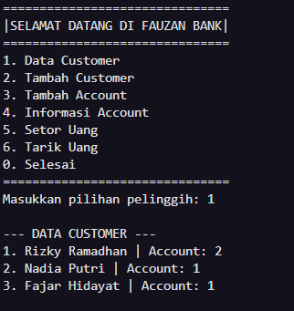
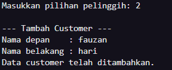
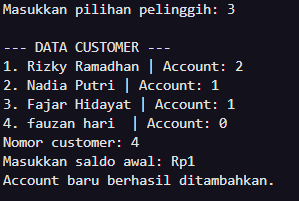
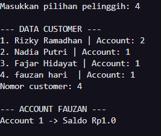
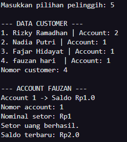
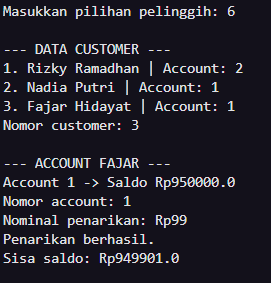

## DOKUMENTASI

# 1. Data Customer 

# 2. Tambah Customer 

# 3. Tambah Account 

# 4. Informasi Account 

# 5. Setor Uang 

# 6. Tarik Uang 

## Struktur Program

Hubungan antar class pada program ini dapat digambarkan sebagai berikut:

```text
Bank
└── Customer[]
    └── Account[]
```

Satu `Bank` dapat menyimpan beberapa `Customer`, sedangkan setiap `Customer` dapat memiliki beberapa `Account`.

### Account

Class `Account` digunakan untuk menyimpan dan mengelola saldo rekening.

Attribute utama:

```java
protected double balance;
```

Method yang tersedia:

- `getBalance()` untuk mendapatkan saldo saat ini.
- `deposit()` untuk menambahkan saldo.
- `withdraw()` untuk melakukan penarikan saldo.

Contoh penggunaan:

```java
Account account = new Account(750000);

account.deposit(250000);
account.withdraw(100000);

System.out.println(account.getBalance());
```

Method `deposit()` dan `withdraw()` mengembalikan nilai `boolean` untuk menunjukkan apakah transaksi berhasil atau tidak.

### Customer

Class `Customer` digunakan untuk menyimpan informasi customer berupa nama depan, nama belakang, dan account yang dimiliki.

Account milik customer disimpan dalam array:

```java
private Account[] accountList;
```

Array tersebut memiliki kapasitas maksimal 5 account.

```java
accountList = new Account[5];
```

Beberapa method yang digunakan pada class ini:

```java
getFirstName()
getLastName()
setAccount()
getAccount()
getNumOfAccounts()
```

Contoh membuat customer dan menambahkan account:

```java
Customer customer = new Customer("Rizky", "Ramadhan");

customer.setAccount(new Account(750000));
customer.setAccount(new Account(1250000));
```

### Bank

Class `Bank` digunakan untuk mengelola kumpulan customer.

Data customer disimpan menggunakan array:

```java
private Customer[] customerList;
```

Pada program ini kapasitas array dibuat untuk menyimpan maksimal 15 customer.

```java
customerList = new Customer[15];
```

Beberapa method yang terdapat pada class `Bank`:

- `addCustomer()` untuk menambahkan customer baru.
- `getNumOfCustomers()` untuk mendapatkan jumlah customer.
- `getCustomer()` untuk mengambil customer berdasarkan index.

Contoh:

```java
Bank myBank = new Bank();

myBank.addCustomer("Rizky", "Ramadhan");
myBank.addCustomer("Nadia", "Putri");

Customer customer = myBank.getCustomer(0);
```

## Main Program

Program dijalankan melalui class:

```text
Main.java
```

Pada class ini dilakukan pembuatan object dan pemanggilan method dari class `Bank`, `Customer`, dan `Account`.

Input dari user menggunakan `Scanner` sehingga beberapa operasi dapat dicoba langsung melalui terminal.

```java
import java.util.Scanner;
```

Menu yang tersedia:

```text
===============================
       PROGRAM BANK MINI
===============================
1. Data Customer
2. Tambah Customer
3. Tambah Account
4. Informasi Account
5. Setor Uang
6. Tarik Uang
0. Selesai
===============================
```

Melalui menu tersebut, user dapat melihat data customer, menambahkan customer dan account baru, melihat saldo, melakukan deposit, serta melakukan penarikan.

Beberapa proses pada main program dipisahkan menjadi method agar kode lebih mudah dibaca:

```java
showCustomers()
showAccounts()
selectCustomer()
selectAccount()
```

## Contoh Output

Saat program dijalankan, data customer dapat ditampilkan seperti berikut:

```text
--- DATA CUSTOMER ---

1. Rizky Ramadhan | Account: 2
2. Nadia Putri | Account: 1
3. Fajar Hidayat | Account: 1
```

Informasi account dari salah satu customer:

```text
--- ACCOUNT RIZKY ---

Account 1 -> Saldo Rp750000.0
Account 2 -> Saldo Rp1250000.0
```

Contoh setelah melakukan deposit:

```text
Nominal setor: Rp250000
Setor uang berhasil.
Saldo terbaru: Rp1000000.0
```

## Struktur File

```text
.
├── Account.java
├── Customer.java
├── Bank.java
├── Main.java
└── README.md
```

## Menjalankan Program

Pastikan Java sudah terinstall. Compile seluruh file dengan perintah:

```bash
javac Account.java Customer.java Bank.java Main.java
```

Setelah proses compile berhasil, jalankan:

```bash
java Main
```

## Hasil Latihan

Melalui program ini, penggunaan array tidak hanya diterapkan pada tipe data biasa, tetapi juga pada object.

Penerapannya terdapat pada:

```java
Customer[] customerList;
```

untuk menyimpan kumpulan object `Customer`, dan:

```java
Account[] accountList;
```

untuk menyimpan kumpulan object `Account` milik setiap customer.

Dengan struktur tersebut, program dapat menggambarkan hubungan sederhana antara `Bank`, `Customer`, dan `Account` sekaligus mencoba penggunaan object, array, constructor, method, dan input menggunakan `Scanner`.
